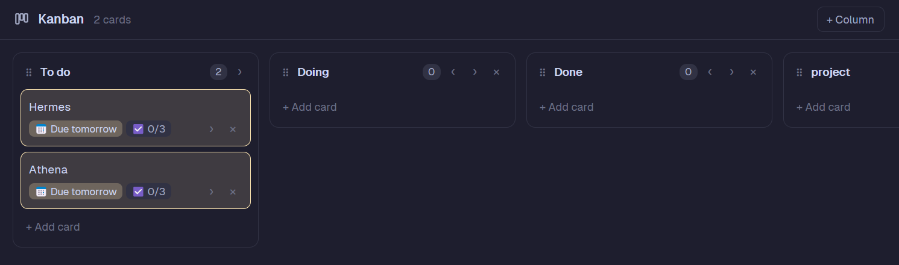

# herdr-kanban

A [Herdr](https://herdr.dev) mod: [`kanban`](kanban/RECIPE.md).

A Kanban board in its own tab. Columns of cards, which you drag between columns or move with
‹ ›. Click a card to open it: title, column, due date, description and a task list. Cards turn
red when overdue, yellow when due today or tomorrow, and blue when due within the week.

## Install

Ask an agent in Herdr to add `https://github.com/enexolgort/herdr-kanban/tree/main/kanban`,
or by hand:

1. Copy `kanban/mods/kanban` to `~/.config/herdr-app/mods/`, the whole folder at once (so
   `mod.json`, which says `"place": "none"`, is there when Herdr first sees it).
2. Merge `kanban/keys.json` into your `~/.config/herdr-app/keys.json`: `ctrl-shift-m` opens a
   Kanban tab. Or run `herdr-app do tab.new --name Kanban --mod kanban`.
3. Run `herdr-app check ~/.config/herdr-app/mods/kanban`.

To give it a button in your tab bar that reuses the space's Kanban tab instead of opening a new
one each time, see [Tab bar button](kanban/RECIPE.md#tab-bar-button).

## What it runs

Nothing. No programs, no network access, and it reads no files. The board is kept in Herdr's
shared state (`kanban.board.main` in `~/.config/herdr-app/shared.json`).

## License

Apache-2.0 (see `LICENSE`).
