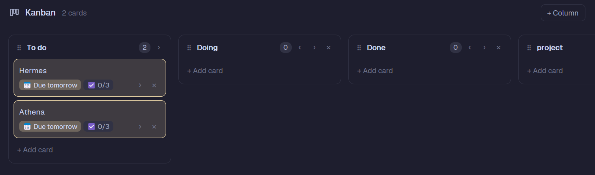

# Kanban

A Kanban board that opens as its own tab: columns of cards you drag around. Click a card to open
it as a dialog with its title, column, due date, description and a task list. Cards take a color
from their due date.



## What you see

- **Header** (44 px, bottom border `border`): `kanban.svg` (three bars) in `muted`, "Kanban" in
  14 px semibold, `N cards` in 12 px `dim`, then a "+ Column" button on the right (28 px, 1 px
  `border`, hover `hover`). While dragging, a hint takes the middle: "Release over a column or
  card to move" (or "…another column to put this one there").
- **Board**: columns side by side, 272 px wide, 12 px apart, 14 px padding. Each column is a
  `surface` card (10 px radius, 1 px `border`):
  - header (26 px): a `⠿` grip (`dim`, grab cursor), the name in 12.5 px semibold, a count pill
    (`hover` background, 11 px `muted`), ‹ › to move the column one place (not shown at the
    ends), and × when the column is empty and isn't the last one;
  - the cards, 6 px apart;
  - "+ Add card" (12 px `dim`, hover `hover`).
- **Card** (`raised`, 8 px radius, 1 px `border`, 9 px padding): the title in 12.8 px
  `foreground`; up to ~90 characters of the description in 11.8 px `muted`; then a row with the
  due badge (`📅 Due tomorrow`, `📅 17 Nov · 4 days`, `📅 Overdue · 2 days`), a task count
  (`☑ 1/3`, on `selected` once all are done), and ‹ › × on the right.
- **Due colors**, by days left (the computer's local date):
  - overdue: `ansi1` (red);
  - today or tomorrow: `ansi3` (yellow);
  - 2 to 7 days: `ansi4` (blue);
  - later, or no date: plain.

  A colored card has that color as its border and as its background at alpha `26` (hex), with
  the badge at `40`. Cards in a column named Done, Archive or Archived never warn: they show the
  plain date.
- **Open card**: a dialog, 540 × 660, `popover` background:
  - top section: "Card" / "Esc" labels, then the title in a 36 px input (15 px semibold);
  - a chip for each column, with the current one in `accent`/`selected`;
  - the Due row: Today, Tomorrow, In a week, Pick… (shows the date when it is none of those),
    the urgency label in its color, and Clear. Pick… opens a month grid under it (252 px,
    ‹ month year ›, M–S headings, the chosen day filled `accent`, today outlined `accent`, other
    months' days `dim`);
  - a scrolling body: "Description", a text area that grows from 3 to 12 rows; "Tasks" with
    `done/total` and a 160 px progress bar (`accent` on `hover`); one row per task (⠿ grip, a
    16 px checkbox, filled `accent` with ✓ when done, the text struck through and `dim` when
    done, ↑ ↓, ×); then an "Add a task, Enter to add" input;
  - footer: "Delete card" (in `blocked`) on the left, "Close" on the right.

## How it behaves

- Opening: `tab.new {name: "Kanban", mod: "kanban"}`. Every copy shows the same board and
  updates live. `props {board: "name"}` opens another board (`kanban.board.<name>`).
- Cards: "+ Add card" turns into an input; Enter adds a card and keeps the input open for the
  next one; Esc, or clicking away with it empty, closes it. Press on a card and release over
  another column (goes to the end) or another card (goes before it) to move it; ‹ › move it one
  column; × deletes it. A click that isn't a drag opens the card.
- Columns: click a name to rename it (Enter or clicking away saves); "+ Column" adds one at the
  end; drag the ⠿ grip onto another column to take its place, or use ‹ ›.
- Open card: the title saves on Enter or blur; column chips move the card; Today, Tomorrow and
  In a week set the date, a day in the grid sets it and closes the grid, and Clear removes it.
  The description saves as you type. Enter in the task input adds a task and clears the input.
  Click the box to tick a task. Click the text to edit it (Enter or blur saves; emptying it
  removes the task). Drag the ⠿ grip onto another task to take its place, or use ↑ ↓. Esc
  closes the dialog. If the card is deleted elsewhere, the dialog says so.
- Due colors re-check every 10 minutes, so they move at midnight without any other change.

## Since 0.2.0

- **Header**, left to right: icon, "Kanban", `N cards` (or `2 of 5 cards` while filtering), a
  220 px search box (⌕, × to clear, accent border while focused), one filter chip per label in
  use (dot + name; on: the label's color at alpha `33`), "Archive" with a count (or "← Board"),
  "+ Column", and a 28 px "?" button. The filter chips take the leftover width and scroll
  sideways; everything else keeps its size. "?" shows a strip of keys under the header.
- **Card**, top to bottom: label pills (the label's color, background at alpha `33`, 10.5 px);
  title; description preview; the linked tab (a `hover` row: status dot, tab name, status word
  in its color — `working`, `blocked` "needs you", `done`, `idle`; "(closed)" in `dim` when the
  tab is gone); then badges: priority ("▲ High" in `ansi5`, "▼ Low" in `dim`), due, tasks.
  Priority also draws a 4 px stripe down the left edge in its color. The selected card has a
  2 px `accent` border and a medium shadow.
- **Open card** rows, each with a 46 px `dim` label: Priority (▼ Low / Normal / ▲ High),
  Labels (chips to toggle, × on a label no card uses, "+ Label" input), Due, Tab ("Link a tab…"
  opens a list of every tab grouped by space, uppercase space names, a status dot per tab, and
  excludes the board's own tab; once linked: "space › tab", its status, Go to tab, Change,
  Unlink). The footer button is "Archive card".
- **Archive view** (replaces the columns): a `dim` line saying what lands here and how many,
  then one row per archived card (`surface`, 8 px radius): labels, title, "Archived 13 Nov ·
  from Done · ☑ 1/1" ("Archived by itself" when automatic), Restore and Delete forever (in
  `blocked`).
- **Status bar block** (`props {status: true}`), like the shipped cost block: `chrome`
  background, top border, 11.8 px. The kanban icon and "1 overdue · 2 due today" in `ansi1`
  when something is overdue, in `ansi3` when only today, or "nothing due" in `dim`. Click:
  show the space's Kanban tab or open one.

Behavior:

- Priority sorts each column on display (high, normal, low; a stable sort, so manual order holds
  within a priority). Shift + ↑ ↓ only swaps cards of the same priority.
- Search: every word must appear in the title, description, task texts, label names or linked
  tab name (case-insensitive). It combines with the single-label filter. A filter on a label
  that stops being used clears itself.
- Keys (board copy, after a click on it or `pane.go`; ignored while an input or the search has
  the keyboard): arrows or h j k l select (left/right jump to the nearest column with cards,
  keeping the row), Enter opens, Shift + ← → moves a column over, Shift + ↑ ↓ swaps with the
  neighbour, n starts "+ Add card" in the selected card's column (else the first), / focuses
  the search, x or Delete archives and selects the next card, ? toggles the key strip, and Esc
  clears an input, then the search, then the strip, then the selection.
- Archive: every save stamps `doneAt` (today) on cards in a finished column and removes it
  elsewhere. Every 10 minutes (and when a board opens), cards whose `doneAt` is 14 days old
  (`ARCHIVE_AFTER`) move to `b.archive` with `auto: true`. Restore removes `doneAt` and appends
  the card to the column it left (or the first).
- Morning notification: from 8:00 local (`MORNING`), the first copy that checks (board on its
  10-minute tick, or status block) sets `kanban.notified.<board>` to today and, if anything is
  overdue or due today, posts `notify({ title: "Kanban: 1 overdue · 2 due today", body: first
  four titles, level: overdue ? "warning" : "info", action: tab.new Kanban })`.

## Built from

- One mod, `mods/kanban` (`main.js`, `mod.json` `{ "place": "none", "title": "Kanban" }`,
  `kanban.svg`). The board and the open card are the same view class: with `props().open` it
  renders the dialog, otherwise the board. A card opens with
  `openOverlay({ mod: "kanban", kind: "dialog", width: 540, height: 660, props: { board, open: cardId } })`.
- State: `shared("kanban.board.<name>")` / `setShared`. The value is
  `{ columns: [{ id, name, cards: [Card] }], labels?: [{ id, name, color }], archive?: [Card & { archivedAt, from, fromName, auto? }] }`
  with `Card = { id, title, description?, due?: "YYYY-MM-DD", priority?: "high" | "low", labels?: [id], link?: { tab, space, name }, doneAt?, tasks?: [{ id, text, done }] }`,
  seeded with To do / Doing / Done (and bug / feature / homelab / idea as labels until the
  board saves its own). Every change clones the board, edits it and sets it again.
- Three modes of one view class: `props().open` (the card dialog), `props().status` (the status
  bar block), else the board. `mod.json` is `focusable`, and the board answers `"focus"` from
  `nextCommand()` by focusing its handle.
- Linked tabs read `spaces()` (each tab's `status`) and `panes()` (an unnamed tab's agent
  name); going there runs `space.select` then `tab.select`.
- gpui-base: `InputState` + `Input` (one at a time on the board, re-created for each edit),
  `TextareaState` + `Textarea` (`set_auto_grow(3, 12)`), `CalendarState`
  (`month_days()[0]`, `prev_month` / `next_month`, drawn by hand).
- Dragging is press/release: `on_mouse_down` on a card or grip records it, `on_mouse_up` on the
  target drops it, `on_hover` marks the target, and the root's `on_mouse_up` cancels.
- `cx.timer.every(600000)` for the date roll-over (board only).

## Tab bar button

The keys.json binding opens a new tab on every press. For a button in a cloned tab bar that
shows the space's Kanban tab when there is one (as the shipped Insights button does), add this
to its `render()`:

```js
const tabIds = new Set(space?.tabs.map(tb => tb.id) ?? []);
const kanban = panes().find(p => p.mod === "kanban" && tabIds.has(p.tab));
this.openKanban = () => {
  if (!kanban) return run("tab.new", { name: "Kanban", mod: "kanban" });
  const zoomed = panes().find(p => p.tab === kanban.tab && p.zoomed);
  if (zoomed && zoomed.pane !== kanban.pane) run("pane.zoom", { pane: zoomed.pane });
  run("pane.focus", { pane: kanban.pane });
};
```

and a button that calls `this.openKanban()` with `svg("mods/kanban/kanban.svg")`. To reach it
from a key, handle `"kanban"` from `nextCommand()` in the tab bar and bind
`"ctrl-shift-m": "<tab bar mod>.kanban"`.

## Watch out

- A scroll area (`overflow_y_scrollbar()`) inside a column sized to its content gets 0 px of
  height and hides every card. The columns have no scroll area of their own: the whole board
  scrolls down and sideways instead.
- There is no `line_clamp`: the description preview is cut by length.
- `InputState`, `TextareaState` and `CalendarState` must be created in `init` or a handler,
  never in `render`.
- A `blur` from an input that has already been replaced must be ignored: each handler checks
  that its input is still the current one.
- `flex_shrink()` needs an argument.
- `herdr-app check` renders only the board with empty shared state. The dialog, the due colors,
  descriptions, the archive view and the status block run only in the app.
- Key events bubble from a focused input to the board, so the key handler must ignore
  everything but Esc while an input or the search has the keyboard, or typing "n" adds a card.
- Several copies run at once (each tab, the status block): the archive sweep and the morning
  check must be safe to repeat. The sweep only moves what is due, and the notification is
  gated by the shared day mark set before it posts.
- Label colors are theme names; a hex alpha (`33`, `40`, `4d`) is appended only when the theme
  color is `#rrggbb`.

## Done when

- `herdr-app check ~/.config/herdr-app/mods/kanban` passes.
- `herdr-app do tab.new --name Kanban --mod kanban` shows To do / Doing / Done.
- An added card shows in its column and is still there after a restart.
- A card dropped on another column moves there. A column dropped by its grip on another
  takes that column's place.
- Clicking a card opens the dialog. A task added there shows `☑ 0/1` on the board card, and
  ticking it makes `1/1`.
- Tomorrow turns the card yellow. A date in the past turns it red, except in Done.
- A description shows under the card's title on the board.
- A card linked to a tab with a working agent shows "working" in the `working` color; clicking
  it switches to that tab.
- Choosing a label filter or typing in the search hides the other cards and the count says "N
  of M cards".
- A High card shows first in its column with a magenta stripe.
- After a click on the board, ↓ selects a card and Enter opens it.
- × on a card puts it in Archive. Restore brings it back to its column.
- The status bar block reads "1 overdue" in red when a card's date has passed.
